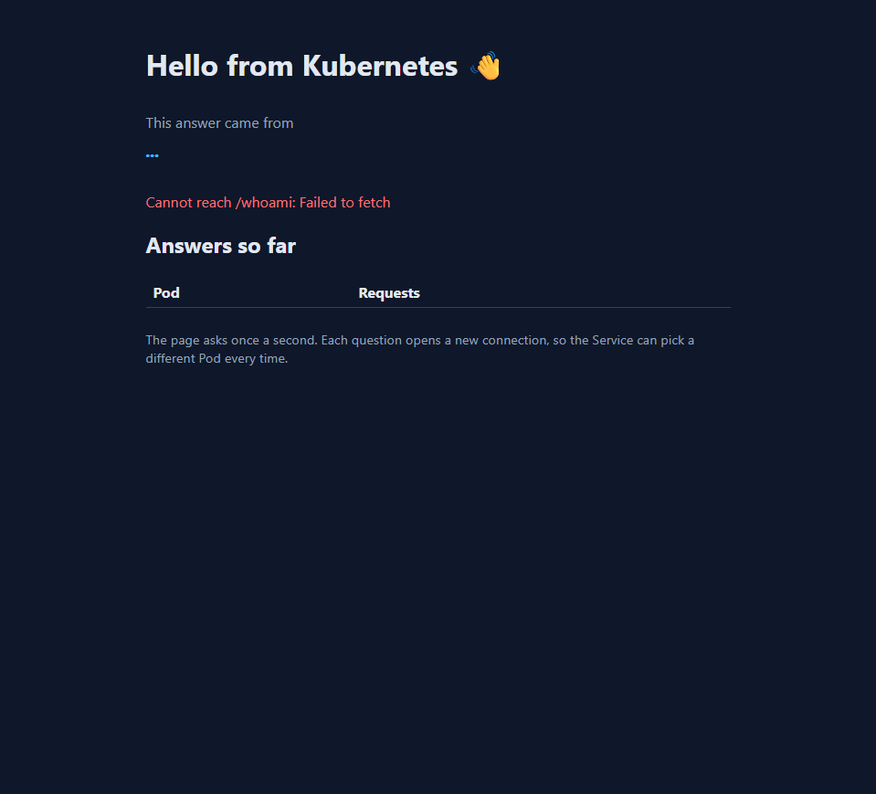

# Lab 2 - hello-app on Kubernetes

Note: I used a 3-node kind cluster (context kind-desktop) instead of the Docker Desktop cluster. kind has no load balancer, so I opened the app with kubectl port-forward.

## 1. My image

```
arshadsait/hello-app:v1
```

## 2. Pods across nodes

```
NAME                         READY   STATUS    RESTARTS   AGE   IP            NODE              NOMINATED NODE   READINESS GATES
hello-app-75b868cd75-f8zsc   1/1     Running   0          14m   10.244.1.5    desktop-worker2   <none>           <none>
hello-app-75b868cd75-l4f44   1/1     Running   0          13m   10.244.1.6    desktop-worker2   <none>           <none>
hello-app-75b868cd75-r4m4f   1/1     Running   0          14m   10.244.3.9    desktop-worker    <none>           <none>
hello-app-75b868cd75-vpmjh   1/1     Running   0          14m   10.244.3.10   desktop-worker    <none>           <none>
```

## 3. The Service and its endpoints

```
NAME        TYPE           CLUSTER-IP      EXTERNAL-IP   PORT(S)          AGE
hello-app   LoadBalancer   10.96.209.230   <pending>     8080:30234/TCP   14m

NAME              ADDRESSTYPE   PORTS   ENDPOINTS                                      AGE
hello-app-f2swp   IPv4          80      10.244.1.6,10.244.3.9,10.244.1.5 + 1 more...   14m
```

## 4. Browser



The page at http://localhost:8080, reached with kubectl port-forward. A port-forward sticks to one Pod, so I forwarded to different Pods to see more than one name in the table.

## 5. The four traps

**Trap 1 - the local image.** The Pods went to ErrImagePull and then ImagePullBackOff. The Events said docker.io/library/hello-app:v1 was not found. The nodes are separate containers with their own image storage, so they cannot see the image in my laptop Docker. A name without a username points to an official Docker Hub image, which does not exist. Pushing it as arshadsait/hello-app:v1 fixed it.

**Trap 2 - the selector typo.** With the Service selector set to helo-app, the EndpointSlice showed `<unset>` for PORTS and ENDPOINTS. No Pod has that label, so the Service had nowhere to send traffic, even though the Service and the Pods both existed. After fixing the typo, the Pod IPs came back on port 80.

**Trap 3 - the wrong targetPort.** With targetPort 8080, the EndpointSlice still listed the Pod IPs, but with port 8080. The Service found the Pods, but nginx listens on port 80, so nothing was listening on 8080. Setting targetPort back to 80 fixed it.

**Trap 4 - the EXTERNAL-IP address.** On my kind cluster the EXTERNAL-IP stays `<pending>`, because kind has no load balancer to assign one. On Docker Desktop the address would be inside Docker private network and not reachable from the laptop, and on a cloud provider it would be a real public address. I used kubectl port-forward and opened http://localhost:8080.

## 6. Your YAML vs the generated YAML

The dry-run output has fields that are not in my file, such as creationTimestamp: null and status (loadBalancer: {}). They are empty or default values. Kubernetes fills in defaults for anything missing, so my shorter file still works.

